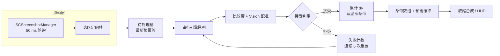
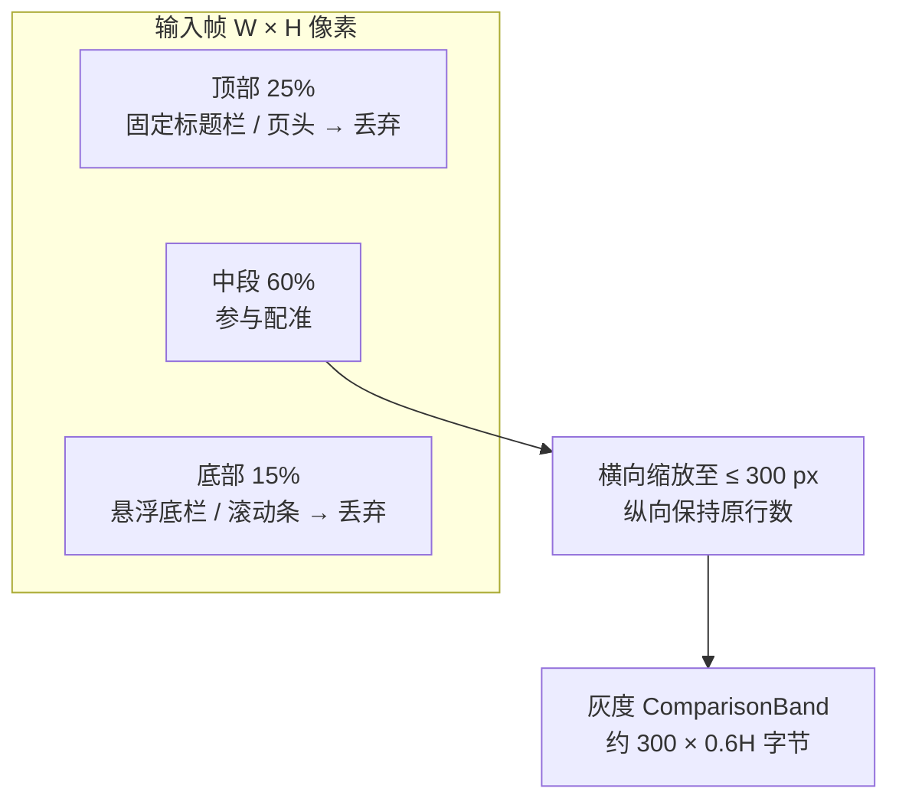
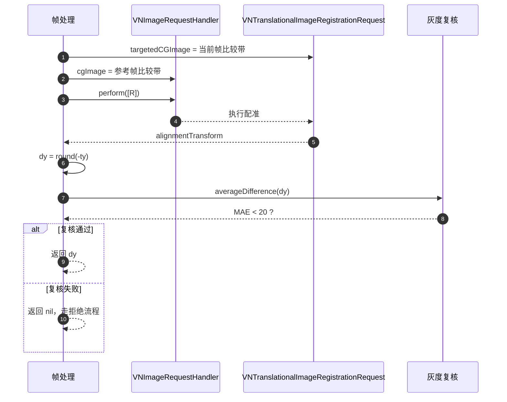
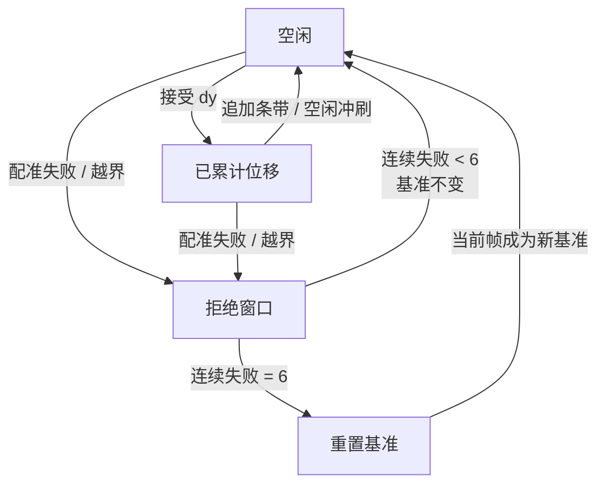
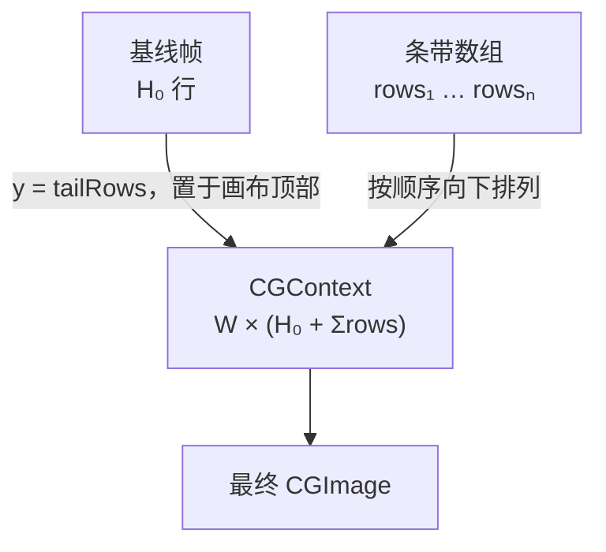
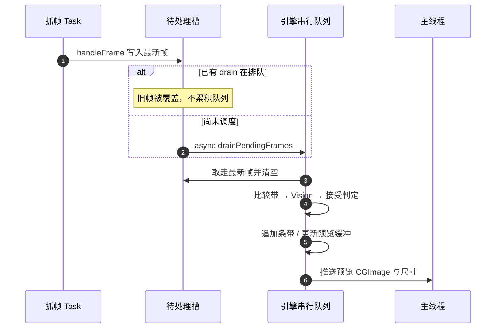

滚动截图（截长图）的本质是：从连续帧中估计纵向位移，把每帧新露出的部分依次追加到一张不断变长的画布上。本文以 macOS 原生实现为例，拆解抓帧、比较带构造、Vision 平移配准、位移接受规则、增量合成与并发模型，并给出复杂度、失效边界和实测数据。

---

## 1. 问题定义

给定一个固定的屏幕选区（宽 `W`、高 `H` 像素），用户在选区内滚动内容，引擎持续抓帧，最终输出一张宽 `W`、高任意的长图。

约束条件：

- **只做纵向平移**：假设选区内的内容是刚体，帧间变化近似为垂直方向的整数像素位移。横向滚动、缩放、窗口重排都不在模型内。
- **帧间必须有重叠**：位移估计依赖两帧的公共内容。若单帧位移超过半帧高，重叠区域不足，中间内容在物理上无法恢复。
- **输出高度不可预知**：不能为每帧保留完整副本，否则内存随滚动时长线性增长且重复存储大量重叠内容。
- **抓帧不能包含本应用 UI**：滚动期间会显示 HUD、选区轮廓和工具栏，它们必须被排除在长图之外。
- **固定表头/底栏会污染配准**：网页的 sticky header、悬浮工具栏在滚动时不动，直接对整帧做配准会把位移估成 0。

## 2. 数据流总览



整个流程只有一条抓帧通道、一个处理队列。抓帧与处理解耦，处理不过来时丢中间帧而不是排队堆积。

## 3. 抓帧：单通道 + 选区定向

### 3.1 为什么不用 SCStream

`SCStream` 是为持续视频流设计的，但在平滑滚动（尤其是浏览器惯性滚动）期间，供帧节奏不稳定，容易拿到重复帧或跳帧。滚动截图的拼接算法对帧间连续性敏感，重复帧可以容忍（`dy = 0` 走空闲逻辑），跳帧则会直接造成内容缺失。

因此这里只保留一条通道：用 `SCScreenshotManager.captureImage` 主动轮询。每次截图有 IPC 开销，实测帧率约 8–15 fps，对正常滚动速度足够。

```swift
captureTask = Task { [weak self] in
    guard let filter = await Self.makeContentFilter(displayID: display.displayID) else { return }
    while !Task.isCancelled {
        try? await Task.sleep(nanoseconds: UInt64(interval * 1_000_000_000))
        guard !Task.isCancelled, let self else { return }

        let config = SCStreamConfiguration()
        config.showsCursor = false
        config.sourceRect = sourceRect
        config.width = pixelWidth
        config.height = pixelHeight

        if let image = try? await SCScreenshotManager.captureImage(
            contentFilter: filter, configuration: config
        ) {
            self.handleFrame(image)
        }
    }
}
```

每轮新建 `SCStreamConfiguration`，避免复用可变配置带来的状态串扰。抓帧失败静默跳过，下一轮继续——滚动截图的生命周期由用户结束动作决定，单次失败不应终止会话。

### 3.2 选区几何

`sourceRect` 使用**显示器本地坐标、左上原点、点值**；AppKit 的选区是**全局坐标、左下原点**。转换公式：

```swift
let screen = display.frame
captureSourceRect = CGRect(
    x: region.minX - screen.minX,
    y: screen.height - (region.maxY - screen.minY),
    width: region.width,
    height: region.height
)
capturePixelWidth  = max(1, Int(region.width  * scale))
capturePixelHeight = max(1, Int(region.height * scale))
```

`y` 的换算顺序是：先把全局坐标平移到显示器本地，再按显示器高度做 Y 翻转。输出像素尺寸显式乘以 `scale`，避免依赖 ScreenCaptureKit 的隐式缩放策略。

### 3.3 排除自身窗口

```swift
let ownApp = content.applications.first {
    $0.bundleIdentifier == Bundle.main.bundleIdentifier
}
return SCContentFilter(
    display: scDisplay,
    excludingApplications: ownApp.map { [$0] } ?? [],
    exceptingWindows: []
)
```

过滤在抓帧层完成，而不是抓完再擦除 HUD。这样长图里不会留下任何覆盖层像素，也不需要维护额外的遮罩区域。

## 4. 比较带：只对画面中段做配准

### 4.1 几何



参数：

| 参数 | 值 | 作用 |
| --- | --- | --- |
| `bandTopRatio` | 0.25 | 丢弃顶部固定区域 |
| `bandBottomRatio` | 0.15 | 丢弃底部固定区域 |
| `comparisonMaxWidth` | 300 px | 横向降采样上限 |

```swift
private static func comparisonBand(_ frame: CGImage) -> ComparisonBand? {
    let w = frame.width, h = frame.height
    let top = Int(CGFloat(h) * bandTopRatio)
    let bottom = Int(CGFloat(h) * bandBottomRatio)
    let bandHeight = h - top - bottom

    guard bandHeight >= 24, w >= 16,
          let crop = frame.cropping(
              to: CGRect(x: 0, y: top, width: w, height: bandHeight)
          ) else { return nil }

    let bandWidth = min(w, comparisonMaxWidth)
    let stride = (bandWidth + 15) / 16 * 16
    var pixels = [UInt8](repeating: 0, count: stride * bandHeight)

    // 绘制到 DeviceGray 位图：横向缩放到 bandWidth，纵向保持 bandHeight
    // ...
    return ComparisonBand(width: bandWidth, height: bandHeight, stride: stride, pixels: pixels)
}
```

`CGImage.cropping(to:)` 使用左上原点，所以 `y = top` 就是裁掉顶部区域。

### 4.2 为什么纵向不缩放

这是整套算法里最关键的一个决定。比较带横向缩到 300 px 以降低配准成本，但**纵向保持原始行数**。于是 Vision 返回的平移量单位就是原始像素行，不需要任何缩放换算：

```text
dy_pixels = round(-ty)
```

如果纵向也缩放，就需要用 `dy_pixels = round(-ty / scaleY)` 还原，缩放比例和取整误差会直接叠加到拼接边界上，长图越高误差越明显。

### 4.3 为什么去掉头尾

固定表头和底栏在滚动中保持不动。对整帧做配准时，这部分内容会持续把估计结果拉向 `dy = 0`，形成系统性偏差。去掉顶部 25%、底部 15%，让配准只依赖真正参与滚动的中间内容。

代价是可用重叠区域变小：比较带高度只有 `0.6H`，有效位移上限随之降低。因此接受规则里的半帧约束以**原始帧高** `H` 为准，而不是比较带高度。

## 5. 位移估计：Vision 平移配准

### 5.1 API 映射

使用 `VNTranslationalImageRegistrationRequest`，它估计两张图之间的纯平移变换，正好匹配滚动截图的运动模型。

```swift
let request = VNTranslationalImageRegistrationRequest(
    targetedCGImage: currentImage, options: [:]
)
let handler = VNImageRequestHandler(cgImage: referenceImage, options: [:])
try handler.perform([request])

guard let observation = request.results?.first
        as? VNImageTranslationAlignmentObservation else { return nil }

let dy = Int((-observation.alignmentTransform.ty).rounded())
```

调用约定：

- **目标图（target）= 当前帧**
- **源图（source）= 参考帧**
- 内容向上移动（页面向下滚动）时，`ty` 为负，取反得到正的 `dy`



### 5.2 符号与坐标系

Vision 的 `alignmentTransform` 是二维仿射变换，纯平移时只有 `tx`、`ty` 两个分量。由于比较带纵向没有缩放，`ty` 的单位就是原始像素行。

方向约定通过自检固定，而不是靠记忆推导：构造一张已知内容的合成图，分别取相差 `expected` 行的两个窗口，断言估计值等于 `expected`。见第 10 节。

### 5.3 灰度复核

Vision 配准在低纹理、重复纹理（如纯色块、等距表格）上可能给出错误但高置信度的结果。追加一次采样平均绝对灰度差（MAE）复核：

```swift
// current 第 r 行应对应 reference 第 r + dy 行
var r = 0
while r < rows {
    let c = r * current.stride
    let p = (r + dy) * reference.stride
    var x = 0
    while x < current.width {
        sum += abs(Int(current.pixels[c + x]) - Int(reference.pixels[p + x]))
        count += 1
        x += 4          // 横向每 4 像素采样一次
    }
    r += 4              // 纵向每 4 行采样一次
}
let mae = Double(sum) / Double(count)
return mae < 20.0
```

两个阈值：

| 条件 | 含义 |
| --- | --- |
| `dy < bandHeight` | 位移必须小于比较带高度，否则没有公共区域 |
| `MAE < 20` | 按估计位移对齐后，两图应高度相似 |

采样步长 4 把复核成本降到完整比较的 1/16，对判断“是否明显错位”已经足够。

## 6. 接受规则与状态机

### 6.1 判定顺序

每帧按固定顺序短路判断：

```text
1. 无基线帧            → 当前帧成为基线
2. 帧尺寸与基线不一致   → 丢弃
3. 比较带尺寸不一致     → 以当前帧重置基准
4. 比较带逐字节相同     → 静止，走空闲逻辑
5. Vision 失败         → 拒绝
6. dy ≤ 0             → 静止，走空闲逻辑
7. dy > H/2           → 拒绝
8. |dy - lastDy| > H/2 → 拒绝
9. 接受：推进基准，累计 dy
```

第 4 步的逐字节比较是廉价快速路径。静止画面（例如用户在阅读）不需要调用 Vision，直接按空闲处理。

第 6 步把 `dy ≤ 0` 归入空闲而不是拒绝：画面变化但内容没有向下移动，可能是视频动画、光标闪烁或用户向上滚动。这些情况不应触发“滚动过快”的提示，也不应推进基准。

### 6.2 接受条件

```swift
let maxDy = frame.height / 2
guard dy <= maxDy,
      lastAcceptedDy == 0 || abs(dy - lastAcceptedDy) <= maxDy else {
    handleReject(band: band, frame: frame, reason: "dy=\(dy)")
    return
}
```

两个约束：

1. **绝对约束**：`0 < dy ≤ H/2`，保证相邻两帧至少有半帧重叠。
2. **连续性约束**：`|dy - lastAcceptedDy| ≤ H/2`，过滤突变。滚动是连续的，一帧突然从 10 行跳到 300 行，大概率是配准错误或页面发生了非滚动变化。

`lastAcceptedDy == 0` 作为通配符：首次接受或刚重置基准时，没有历史位移可比较，只检查绝对约束。

### 6.3 失败处理

失败帧**不推进参考基准**。这一点很重要：参考帧始终是最后一次成功配准的帧，下一次估计仍然以它为基准，避免错误结果污染后续所有帧。



连续失败计数到 3 时，HUD 提示“滚动过快或内容变化大，请慢一点滚动”。到 6 时重置基准：

```swift
referenceBand = band
referenceFrame = frame
lastAcceptedDy = 0
accumulatedDy = 0
consecutiveFailures = 0
```

重置意味着承认这一段的帧间重叠已经不足，中间内容无法恢复。未落盘的累计位移被清零，避免把不可信的内容追加进长图。重置后以当前帧继续，不阻塞后续滚动。

### 6.4 空闲冲刷

当位移累计不足 2 行时，内容不会立即落盘。如果用户此时停止滚动，这最后几行就会丢失。因此空闲路径会在内容停止变化 0.35 秒后，把 `accumulatedDy` 行从参考帧底部裁下来追加：

```swift
private func handleIdle(scale: CGFloat) {
    let now = CACurrentMediaTime()
    if accumulatedDy > 0, now - lastFrameChangeTime >= idleFlushDelay,
       let frame = referenceFrame {
        appendTail(from: frame, rows: accumulatedDy, scale: scale, reason: "空闲冲刷")
    }
}
```

从参考帧底部裁 `accumulatedDy` 行是正确的：自上次落盘以来内容总共上移了 `accumulatedDy` 行，参考帧最底部的这部分正是长图尚未覆盖的新内容。

## 7. 增量合成

### 7.1 数据模型

长图不保存为一张不断变大的位图，而是：

```swift
private var baselineImage: CGImage?
private var strips: [(image: CGImage, rows: Int)] = []

private var compositeTotalHeight: Int {
    (baselineImage?.height ?? 0) + strips.reduce(0) { $0 + $1.rows }
}
```

- **基线帧**：第一帧，提供初始 `H` 行。
- **条带数组**：每次接受位移后，从当前帧底部裁出 `rows` 行，作为独立小图追加。

条带追加是 O(1) 的数组操作，不做全图重绘。若每帧都把“基线 + 已有条带”重新画一遍，总成本会退化为 O(N²)。

### 7.2 裁行必须实体化

`CGImage.cropping(to:)` 返回的图可能仍然引用父图的数据提供者。如果直接保存裁剪结果，每个条带都会隐式持有整帧的像素缓冲区，内存迅速膨胀。

因此裁剪后再画进一个独立 `CGContext`：

```swift
guard let crop = image.cropping(to: CGRect(
          x: 0, y: CGFloat(image.height - rows),
          width: CGFloat(image.width), height: CGFloat(rows)
      )),
      let ctx = CGContext(
          data: nil, width: crop.width, height: crop.height,
          bitsPerComponent: 8, bytesPerRow: 0,
          space: CGColorSpaceCreateDeviceRGB(),
          bitmapInfo: CGImageAlphaInfo.premultipliedLast.rawValue
      ) else { return nil }

ctx.draw(crop, in: CGRect(x: 0, y: 0, width: CGFloat(crop.width), height: CGFloat(crop.height)))
return ctx.makeImage()
```

这一步把条带复制到自己的缓冲区，父帧随后可以被释放。

### 7.3 收尾合成



`CGContext` 的坐标原点在左下角，而长图的视觉顺序是自上而下。因此：

```swift
let tailRows = totalH - baseline.height
ctx.draw(baseline, in: CGRect(
    x: 0, y: CGFloat(tailRows),
    width: CGFloat(w), height: CGFloat(baseline.height)
))

var y = tailRows
for strip in strips {
    y -= strip.rows
    ctx.draw(strip.image, in: CGRect(
        x: 0, y: CGFloat(y),
        width: CGFloat(w), height: CGFloat(strip.rows)
    ))
}
```

基线放在最高处 `y = tailRows`，第一条条带紧贴其下，依次向下。整张画布只在用户点击保存/复制/结束时绘制一次，成本 O(输出像素数)。

### 7.4 独立预览缓冲

HUD 需要实时缩略图。如果每次都用完整长图生成预览，成本会随已捕获高度线性增长。这里维护一个独立的 236 px 宽灰度缓冲：

```swift
private let previewWidth = 236
private var previewPixels: [UInt8]?
private var previewRows = 0
private var previewCarry: CGFloat = 0
private var previewPending: [(image: CGImage, rows: Int)] = []
```

- 新条带按 `previewScale = 236 / W` 缩放后追加到 `previewPixels`，成本只与新增行数有关。
- 慢速滚动时，一条条带可能不足 1 个预览行。`previewCarry` 保存小数余量，攒够整行再落盘。
- 多条不足 1 行的条带先进入 `previewPending`，合并成一张图后再统一降采样，保证顺序与比例正确。

预览缓冲的字节数只与长图高度成线性关系（每行 236 字节），且不需要重复读取已有像素。

## 8. 并发模型

参与线程/队列：

| 执行体 | 职责 |
| --- | --- |
| 抓帧 `Task` | 每 50 ms 调用一次 `SCScreenshotManager` |
| 引擎串行队列 | 比较带、Vision、条带追加、预览更新 |
| 主线程 | HUD 刷新、结束回调 |

### 8.1 待处理槽：最新帧覆盖



`handleFrame` 可以从任意线程调用，用 `NSLock` 保护槽位：

```swift
func handleFrame(_ frame: CGImage) {
    guard isRunning else { return }
    pendingLock.lock()
    pendingFrame = frame
    let needsDrain = !drainScheduled
    drainScheduled = true
    pendingLock.unlock()

    guard needsDrain else { return }
    queue.async { [weak self] in self?.drainPendingFrames() }
}
```

如果处理速度跟不上抓帧速度，中间的帧会被覆盖丢弃，只保留最新帧。这是有意的取舍：

- **优点**：延迟不累积，HUD 始终反映最新画面，内存占用恒定。
- **代价**：被丢弃帧之间的位移必须由剩余帧承担。若丢帧导致相邻处理帧的位移超过 `H/2`，配准会失败并触发拒绝/重置。

因此 50 ms 的抓帧间隔、约 20 ms 的单帧处理成本，与“正常滚动速度下单步位移远小于半帧”这一前提共同成立时，方案才稳定。

### 8.2 结束时的队列屏障

`finish` 不在调用线程直接读长图，而是把收尾工作排到引擎队列末尾：

```swift
queue.async { [weak self] in
    guard let self else { return }
    self.running = false
    let composite = self.composeFull()
    DispatchQueue.main.async {
        finished?(cancelled ? nil : composite, consumed)
    }
}
```

串行队列保证收尾一定在最后一个在途帧处理完之后执行；`running = false` 让之后才被 drain 的帧直接返回，避免与最终合成竞态。

## 9. 复杂度与实测

设：

- `W × H`：单帧像素尺寸
- `Wb × Hb`：比较带尺寸（`Wb ≤ 300`，`Hb ≈ 0.6H`）
- `Hout`：最终长图高度
- `rows`：单次追加行数

| 阶段 | 复杂度 | 说明 |
| --- | --- | --- |
| 比较带构建 | O(Wb × Hb) | 每帧一次，灰度 + 横向缩放 |
| Vision 配准 | 与 Wb × Hb 相关 | 每帧一次 |
| 灰度复核 | O(Wb × Hb / 16) | 4×4 采样 |
| 条带追加 | O(W × rows) | 只复制新增行 |
| 预览追加 | O(236 × rows × previewScale) | 与长图总高无关 |
| 收尾合成 | O(W × Hout) | 仅一次 |
| 内存 | O(W × Hout) + O(单帧) | 条带实体化后不持有父帧 |

实测环境：2x 显示器，选区 500×400 pt（1000×800 px），Chrome 测试页，10 次 80 pt 滚动。

| 指标 | 结果 |
| --- | --- |
| 单次滚动位移 | 160 px（80 pt × 2） |
| 长图尺寸 | 1000×2400 |
| 追加序列 | 320 + 8×160 行（另一次运行为 10×160） |
| 总帧数 | 194–199 |
| 滚动帧耗时 | 约 22 ms（含 Vision） |
| 静止帧耗时 | 约 3 ms（逐字节比较快速路径） |

## 10. 验证方法

### 10.1 合成图案自检（无需屏幕权限）

构造一张 900×2400 的非周期随机线条图，分别裁出 `y = 200` 和 `y = 200 + expected` 两个 900×700 窗口，送入同一套比较带与 Vision 流程，断言输出等于 `expected`。

```bash
Snipin.app/Contents/MacOS/Snipin --selftest-shift
```

```text
SELFSHIFT: expected=10  got=10
SELFSHIFT: expected=40  got=40
SELFSHIFT: expected=90  got=90
SELFSHIFT: expected=160 got=160
SELFSHIFT: expected=240 got=240
```

该自检同时固定了三件事：符号方向、像素单位、整数取整行为。任何一项改动（例如交换 target/source）都会立刻失败。

### 10.2 端到端自检

```bash
Snipin.app/Contents/MacOS/Snipin --selftest-scroll
```

输出长图尺寸、追加日志与总帧数，并把结果保存到 `/tmp/selfscroll-result.png` 供人工核对接缝。测试页内容按顺序唯一（240 行编号），便于检查重复或缺失。

## 11. 失效模式与边界

| 场景 | 表现 | 处理 | 结果 |
| --- | --- | --- | --- |
| 单次滚动 > H/2 | 帧间重叠不足 | 连续 6 次失败后重置基准 | 中间内容丢失，后续继续 |
| 固定表头 / 底栏 | 配准被拉向 0 | 比较带去掉顶部 25%、底部 15% | 通常可消除 |
| 重复纹理 / 纯色区域 | Vision 给出错误位移 | 灰度 MAE 复核 | 拒绝该帧 |
| 视频 / 动画 | 有变化但无位移 | `dy ≤ 0` 走空闲 | 不追加、不误报 |
| 向上滚动 | `dy < 0` | 走空闲 | 不追加 |
| 横向滚动 / 页面缩放 | 平移模型不成立 | 复核失败 | 拒绝或重置 |
| 抓帧期间窗口尺寸变化 | 帧尺寸与基线不一致 | 直接丢弃该帧 | 基线保持不变 |
| 处理速度慢于抓帧 | 中间帧被覆盖 | 丢弃中间帧 | 位移过大时触发重置 |
| 输出极高 | 内存与 CGImage 限制 | 当前实现未设显式上限 | 受系统资源约束 |

最本质的限制是重叠：滚动截图不是“无限画布”，而是“用重叠换连续”。单步位移一旦超过半帧，任何配准算法都无法恢复中间内容，只能重置并接受断点。

## 12. 参数速查

| 参数 | 值 | 调整影响 |
| --- | --- | --- |
| `captureInterval` | 0.05 s | 更小：帧更密，IPC 与处理压力更大 |
| `bandTopRatio` | 0.25 | 更大：更抗固定页头，可用重叠更少 |
| `bandBottomRatio` | 0.15 | 同上 |
| `comparisonMaxWidth` | 300 px | 更小：更快，但低纹理区分辨率下降 |
| `appendThreshold` | 2 行 | 更小：追加更频繁；更大：条带更少但空闲尾部更依赖冲刷 |
| `idleFlushDelay` | 0.35 s | 更小：尾部更快落盘，可能误判平滑滚动间隙 |
| `resetAfterFailures` | 6 | 更小：更快恢复，更容易在短暂配准失败时丢内容 |
| MAE 阈值 | 20 | 更小：更严格，弱纹理页面更易被拒 |

## 13. 可迁移的设计要点

1. **用原生配准替代手写金字塔匹配**：`VNTranslationalImageRegistrationRequest` 在精度和代码量上都优于自实现的 SAD/ORB 流程；手写金字塔还需要处理分带、连续性先验和周期纹理别名。
2. **纵向不缩放**：配准结果的单位直接等于输出单位，消除一类换算误差。
3. **比较带而非整帧**：固定 UI 是位移估计的主要噪声源，几何裁剪比事后加权更简单可靠。
4. **失败帧不推进基准**：错误结果不能进入参考状态，否则一次误配准会污染后续整段。
5. **增量数据结构 + 收尾一次性合成**：把 O(N²) 的全图重绘降为 O(N) 的条带追加。
6. **预览与成品分离**：实时预览用独立低分辨率缓冲，成本不随长图高度增长。
7. **最新帧覆盖而不是排队**：实时系统里，延迟比完整性更重要；完整性由重叠约束和重置策略兜底。

---

参考实现：Snipin `ScrollCaptureEngine.swift`（macOS 14+，ScreenCaptureKit + Vision + CoreGraphics）。
